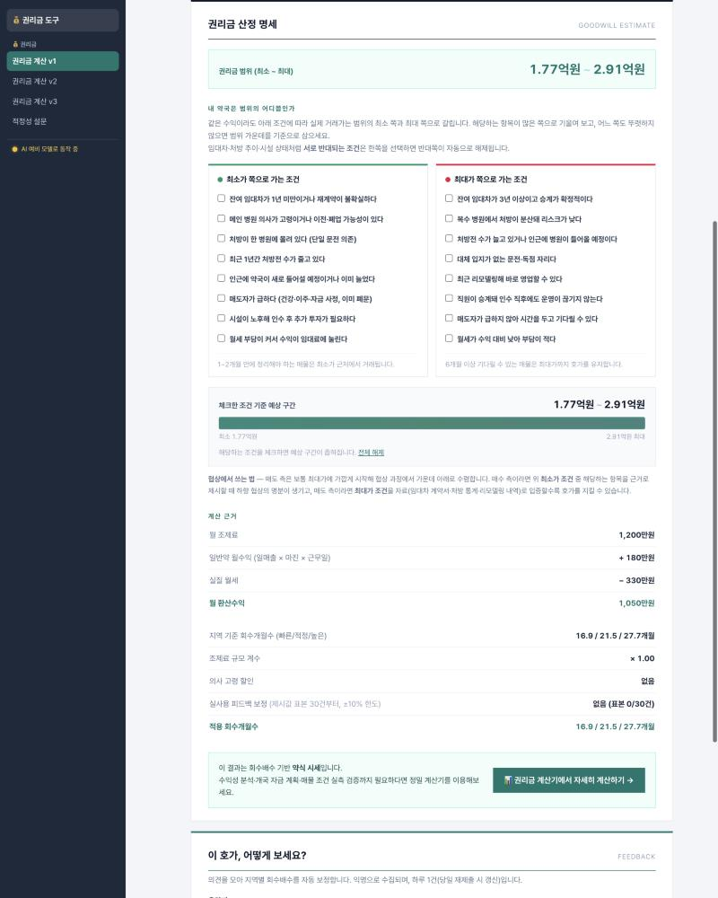
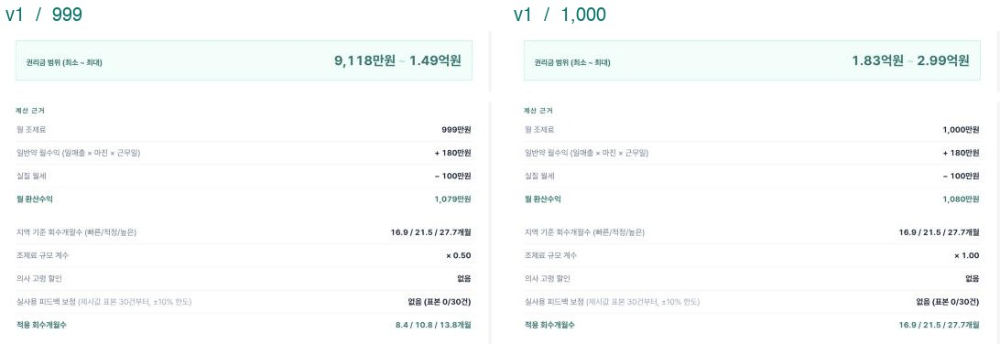
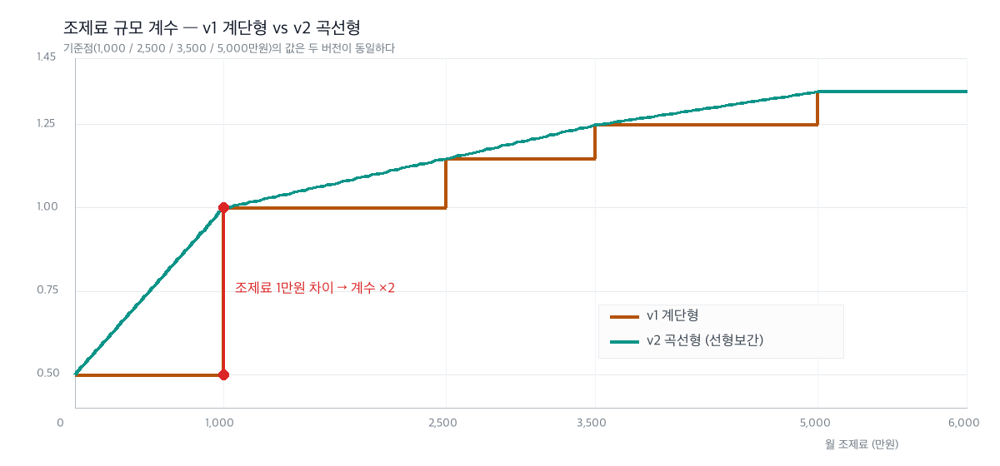
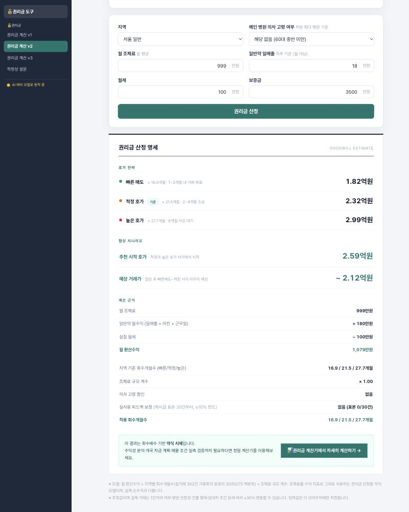
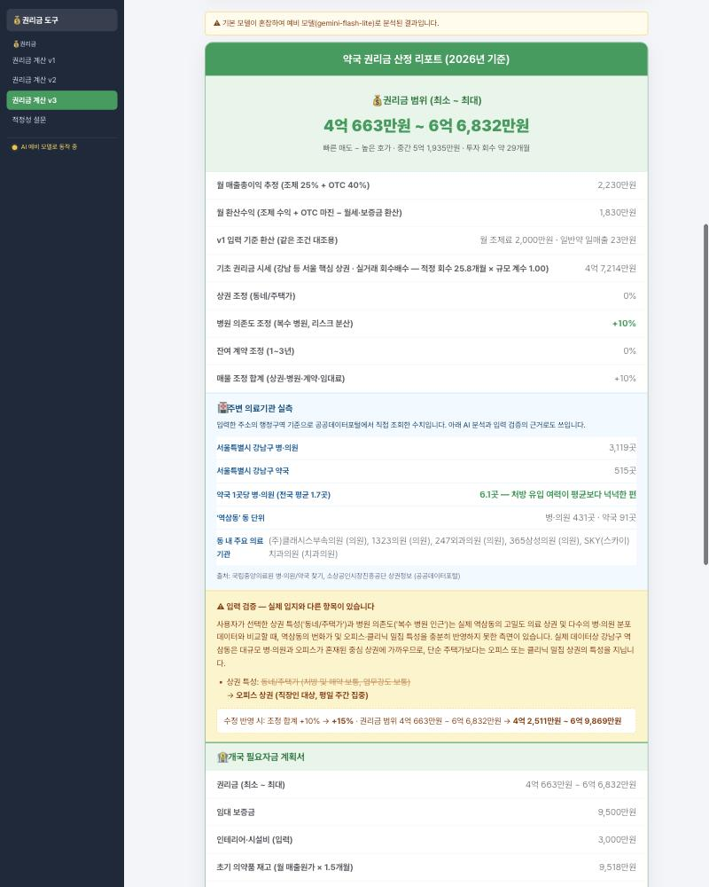
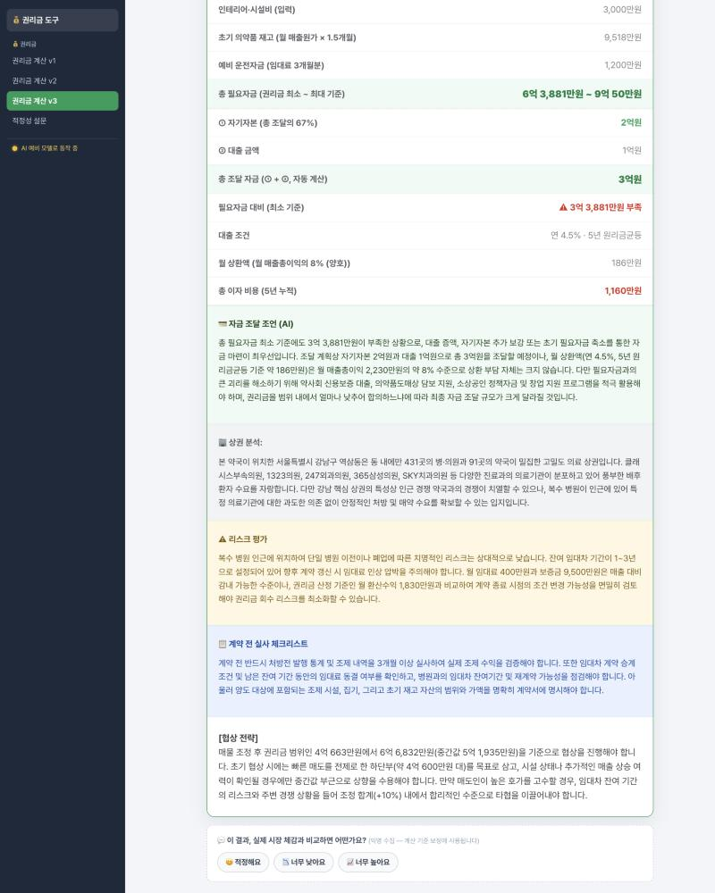
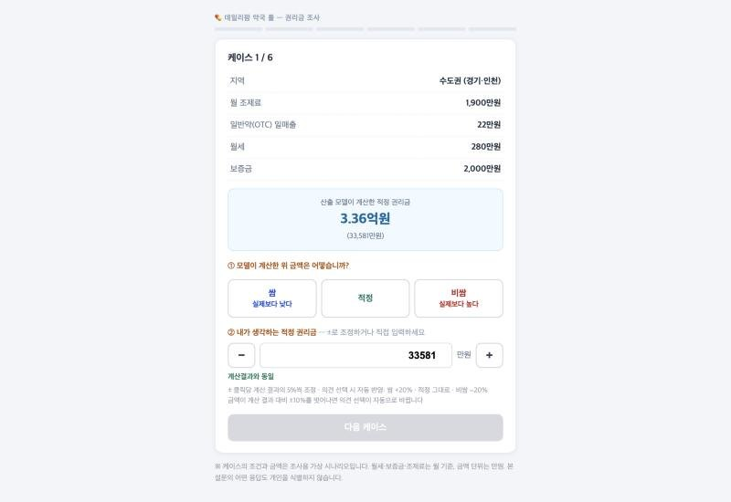

# 권리금 계산기 — 개발 히스토리

> 아이디어가 어떻게 검증되고 상품이 되었는지의 기록입니다.
> 계산식·조사 데이터·화면·프롬프트를 실제로 쓴 형태 그대로 싣습니다.
> 관련 문서: [개발 목적과 배경](01-개발-목적과-배경.md) · [발표자료](03-프로젝트-발표자료.md) · [조사 원자료](data/2026-09-권리금-적정성-조사.csv) · [검증 스크립트](data/verify-model.php)
> 작성 기준일: 2026-11

---

## 목차

| 장 | 내용 |
|---|---|
| [0단계](#1장-0단계--계산식보다-정답지를-먼저-만들었다) | 조사지를 먼저 돌려 '정답지'를 만들고, 두 계산식을 같은 케이스에 돌려 비교 |
| [v1](#2장-v1--계단형-계산식과-절벽) | 회수배수 계산식 구현 · 검증 · 경계에서 발견한 절벽 |
| [v2](#3장-v2--절벽을-깎는다) | 완만하게 만드는 방법 탐색 · 작업 프롬프트 · 선형보간 · 검증 |
| [v3](#4장-v3--입력할-수-없는-데이터를-가져온다) | 외부 데이터 목록과 적용 · AI 프롬프트 설계와 실패 사례 · 검증 |
| [상시화](#5장-그-다음--검증을-일회성에서-상시로) | 설문을 DB에 적재해 계산식이 스스로 보정되게 |

```
0단계   현장의 감을 숫자로 받아오기      20케이스 조사 → 두 계산식을 같은 데이터에 돌려 선택
  ↓
v1      회수배수 계산식 + 구간 배율      결과는 나오지만 구간 경계에서 금액이 2배로 튐
  ↓
v2      절벽을 완만하게                  기준점은 보존하고 사이를 선형보간
  ↓
v3      외부 데이터 + AI 결합            공공데이터·카카오로 실측, Gemini는 서술만
  ↓
상시화  설문 → DB 적재 → 계수 보정        일회성 검증을 반복 가능한 구조로
```

---

# 1장. 0단계 — 계산식보다 '정답지'를 먼저 만들었다

## 왜 조사부터 했나

계산기를 만들 때 가장 쉬운 유혹은 **그럴듯한 식을 먼저 세우는 것**입니다. 하지만 권리금에는 정답표가 없습니다.
식을 먼저 만들면 그 식이 맞는지 확인할 방법이 영영 생기지 않습니다.

그래서 순서를 뒤집었습니다. **현장의 감이 어떤 숫자인지부터 받아오고**, 그 숫자를 정답지 삼아 계산식을 맞췄습니다.

## 조사지는 이렇게 생겼다

가상의 약국 조건 **20케이스**를 지역 5개 권역 × 규모별로 구성했습니다. 월 조제료·OTC 비율·일반약 일매출·월세·보증금을
랜덤하게 흩뿌리고 반올림해, 특정 패턴이 읽히지 않게 했습니다. 그리고 **계산기가 산출한 3단계 금액을 숨기지 않고 함께 적었습니다.**

실제 조사지의 일부입니다 (금액 단위 만원, 전체는 [원자료 CSV](data/2026-09-권리금-적정성-조사.csv)).

| 케이스 | 지역 | 월 조제료 | OTC 비율 | 일반약 일매출 | 월세 | 보증금 | 빠른매도 | 적정호가 | 높은호가 | **내가 보는 적정 권리금** |
|---|---|---|---|---|---|---|---|---|---|---|
| 2 | 강남 등 서울 핵심 상권 | 2,900 | 30% | 29 | 460 | 8,500 | 55,300 | 70,300 | 90,700 | ______ |
| 7 | 서울 일반 | 1,200 | 44% | 18 | 330 | 3,500 | 15,400 | 19,600 | 25,200 | ______ |
| 9 | 수도권 (경기·인천) | 800 | 50% | 13 | 160 | 4,000 | 6,512 | 7,739 | 9,980 | ______ |
| 14 | 광역시 (부산·대구 등) | 2,700 | 38% | 34 | 200 | 4,000 | 38,600 | 57,500 | 75,500 | ______ |
| 17 | 지방 중소도시 | 1,500 | 37% | 19 | 140 | 2,500 | 16,400 | 24,400 | 32,100 | ______ |

모델가를 같이 보여준 것은 의도였습니다. 백지에서 금액을 적게 하면 답이 흩어지지만, 옆에 숫자가 있으면
**"이건 높다 / 낮다"는 판단이 함께 나옵니다.** 처음부터 목적이 '정답 수집'이 아니라 **'오차 측정'** 이었기 때문입니다.

| 회차 | 응답 | 쓰임 |
|---|---|---|
| 1차 | 조사원 2명 × 20케이스 = **40응답** | 어느 계산 방식이 현장과 맞는지 — **모델 선택** |
| 2차 | 3번째 조사원 추가 → **60응답** | 선택한 모델의 **계수 보정** |

## 같은 케이스에 두 계산식을 돌렸다

### 모델 A — 일반 상가식

시중 권리금 계산기가 쓰는 방식입니다. 업종을 가리지 않고 같은 배수를 씁니다.

```
월 매출총이익 = 월 조제 수익 + (일반약 일매출 × OTC 마진 40% × 월 근무일 25일)
권리금        = 월 매출총이익 × 12개월
```

### 모델 B — 회수배수 (약국 특화)

지역과 규모를 상수가 아니라 **변수**로 둡니다.

```
월 환산수익  = 조제 수익 + OTC 마진 − (월세 + 보증금 기회비용)
권리금       = 월 환산수익 × 지역 회수개월수(p30/p50/p75) × 조제료 규모 계수
```

지역 회수개월수는 지역별로 3개(빠른 매도 p30 / 적정 p50 / 높은 호가 p75)를 두어 **결과가 범위로** 나옵니다.

### 어떻게 돌렸나

1. 20케이스의 입력값을 두 식에 각각 넣어 금액을 산출합니다.
2. 조사원 응답이 **산출 범위 안에 들어왔는지**를 셉니다 (모델 A는 단일값이라 10~14개월을 범위로 간주).
3. 범위 적중만으로는 '어느 쪽으로 틀렸는지'를 알 수 없으므로, **응답 대비 모델 배율**을 함께 봅니다.
   규모 구간(조제료 1,000만원 기준)으로 나눠 중앙값을 내면 편향의 방향이 드러납니다.

이 계산은 지금도 그대로 재현됩니다.

```bash
php doc/data/verify-model.php
```

## 결과 — 모델 A는 '평균적으로' 틀린 게 아니라 '구조적으로' 틀렸다

| 계산 방식 | 1차 40응답 범위 적중 |
|---|---|
| 모델 A — 월 매출총이익 × 12개월 | **7 / 40** (18%, 당시 기록) |
| 모델 B — 지역 회수개월수 × 규모 계수 | **32 / 40** (80%, 당시 기록) |

중요한 건 적중률 자체가 아니라 **틀린 방향**이었습니다. 원자료로 다시 계산한 모델 A의 편향입니다.

| 규모 | 모델 A ÷ 응답 (중앙값) | 범위 | 해석 |
|---|---|---|---|
| 월 조제료 1,000만원 미만 | **3.03배** | 1.59 ~ 4.16배 | 작은 약국을 3배로 과대평가 |
| 월 조제료 1,000만원 이상 | **0.67배** | 0.46 ~ 1.15배 | 문전 대형을 응답의 2/3로 과소평가 |

한 방향으로 치우친 오차라면 배수만 조정하면 됩니다. 그런데 모델 A는 **소형에서 3배 높고 대형에서 3분의 1 낮습니다.**
어떤 배수를 넣어도 동시에 맞출 수 없습니다. 지역·규모·저수익을 전부 상수로 취급한 식의 구조적 한계입니다.

> 이 단계가 없었다면 "계산기를 만들었다"로 끝났을 것입니다.
> **먼저 정답지를 만들어 두었기 때문에, 이후 모든 변경을 숫자로 평가할 수 있었습니다.**

---

# 2장. v1 — 계단형 계산식과 '절벽'

## v1이 실제로 하는 계산

검증에서 살아남은 모델 B를 그대로 코드로 옮겼습니다. 다섯 단계입니다.

```
[1] 월 환산수익
    보증금 기회비용 = 보증금 > 3억이면 (보증금 × 연 5%) ÷ 12, 아니면 0
    월 환산수익     = 월 조제 수익 + (일반약 일매출 × 0.4 × 25일) − (월세 + 보증금 기회비용)

[2] 조제료 규모 계수 — 구간별 고정값 (계단형)
    조제료 < 1,000       → 0.50
    1,000 ≤ 조제료 < 2,500 → 1.00
    2,500 ≤ 조제료 < 3,500 → 1.15
    3,500 ≤ 조제료 < 5,000 → 1.25
    5,000 ≤ 조제료       → 1.35

[3] 3단계 가격 + 저수익 임계 처리
    월 환산수익 < 700만원          → 시설양도비 고정 (3,000 / 5,000 / 8,000만원)
    700 ≤ 월 환산수익 < 1,000만원   → 저수익 할인 = 0.5 + (수익 − 700) ÷ 300 × 0.5   (0.5 → 1.0 선형)
    그 외                          → 할인 없음 (1.0)

    빠른매도 = 월 환산수익 × 지역 p30 × 규모 계수 × 저수익 할인
    적정호가 = 월 환산수익 × 지역 p50 × 규모 계수 × 저수익 할인
    높은호가 = 월 환산수익 × 지역 p75 × 규모 계수 × 저수익 할인

[4] 의사 고령 할인 — 65세 이상 ×0.7, 75세 이상 ×0.5 (시설양도비 구간은 미적용)

[5] 보정 — 지역 피드백 보정(표본 30건+, ±10% 한도) × 설문 보정(±15% 한도)
```

지역 회수개월수는 이 표를 씁니다 (2026-09 조사 반영 후).

| 지역 | 빠른매도 p30 | 적정 p50 | 높은호가 p75 |
|---|---|---|---|
| 강남 등 서울 핵심 상권 | 20.2 | 25.8 | 33.2 |
| 서울 일반 | 16.9 | 21.5 | 27.7 |
| 수도권 (경기·인천) | 17.7 | 21.0 | 27.1 |
| 광역시 | 13.6 | 20.2 | 26.6 |
| 지방 중소도시 | 12.2 | 18.2 | 23.9 |

핵심 구현은 `src/config.php` 의 `gwBaseQuote()` 한 곳에 있습니다.

```php
// 1. 월 환산수익 (보증금 기준 초과분의 연 환산 기회비용을 월세에 가산)
$depositAdj = $deposit > $weights['deposit_threshold'] ? $deposit * $weights['deposit_rate'] / 12 : 0;
$profit = $prescProfit + $otcProfit - ($rent + $depositAdj);

// 2. 조제료 규모 계수 (조제료가 클수록 회수기간을 길게 인정 → 권리금 상향)
if ($prescProfit < 1000)      { $prescMult = $multTable['under1000']; }
elseif ($prescProfit < 2500)  { $prescMult = $multTable['b1000']; }
// … 이하 동일

// 3. 3단계 가격 + 저수익 임계점 처리
$quick = $profit * $regionMonths['p30'] * $prescMult * $cautionMult;
$fair  = $profit * $regionMonths['p50'] * $prescMult * $cautionMult;
$high  = $profit * $regionMonths['p75'] * $prescMult * $cautionMult;
```

## 화면

결과는 금액 하나가 아니라 **범위**로 보여주고, 그 범위 안에서 어디쯤인지를 체크리스트로 좁히게 했습니다.
아래쪽 '계산 근거'에 월 환산수익·회수개월수·규모 계수·할인·보정이 모두 드러납니다 — **왜 그 금액인지 설명할 수 있어야 한다**는 것이 이 프로젝트의 전제이기 때문입니다.



## v1 검증 — 60응답으로 다시 맞췄다

3번째 조사원까지 합친 60응답으로 대조하니 두 가지가 드러났습니다.

- 조제료 1,000만원 **이상** 17케이스에서 모델이 일관되게 낮았습니다 (응답 ÷ 모델 중앙값 **1.156**).
  지역별 편차가 1.08~1.17로 좁아 **특정 지역 문제가 아니라 전체 수준 문제**로 판단했습니다.
- 조제료 1,000만원 **미만** 3케이스는 반대로 모델이 높았습니다 (**0.647**). 조사원 3명이 모두 모델의 절반 수준으로 봤습니다.

그래서 두 군데만 손봤습니다 — **전 지역 회수개월수 ×1.15**, **소형 구간 규모 계수 0.88 → 0.50**.

| 지표 | 보정 전 | 보정 후 |
|---|---|---|
| 범위 적중률 | 41/60 (68%) | **51/60 (85%)** |
| 응답 ÷ 모델 중앙값 | 1.129 | **0.999** |
| 소형 구간 (조제료 <1,000) | 0.647 | **0.992** |
| 일반 구간 (조제료 ≥1,000) | 1.156 | **1.006** |

조사원별로 보면 보정의 효과가 더 분명합니다. 특히 조사원 3은 **9/20 → 18/20** 으로 바뀌었습니다.

| 조사원 | 보정 전 적중 | 보정 후 적중 | 보정 후 ratio 중앙값 | 성향 |
|---|---|---|---|---|
| 조사원 1 | 18/20 | **18/20** | 0.988 | 모델과 가장 가까움 |
| 조사원 2 | 14/20 | **15/20** | 0.870 | 전반적으로 보수적 |
| 조사원 3 | 9/20 | **18/20** | 1.098 | 높게 보는 편 — 보정으로 흡수 |

남은 9건의 불일치는 대부분 **같은 케이스를 두고 조사원끼리 갈린** 경우입니다 (예: 케이스 7 — 2.0억 / 1.7억 / 3.0억).
모델이 틀렸다기보다 **현장 감각 자체의 분산**이며, 표본을 늘려야 좁혀지는 영역입니다.

## 그런데 — 경계에서 그래프가 끊겼다

구간별 고정 계수에는 대가가 있었습니다. **구간이 바뀌는 지점에서 금액이 절벽처럼 튑니다.**

같은 조건(서울 일반 · 일반약 일매출 18만원 · 월세 100만원 · 보증금 3,500만원)에서 **조제료만 1만원** 바꿔 본 결과입니다.



| 월 조제료 | 규모 계수 | 권리금 범위 |
|---|---|---|
| 999만원 | 0.50 | **9,118만원 ~ 1.49억원** |
| 1,000만원 | 1.00 | **1.83억원 ~ 2.99억원** |

**조제료 1만원 차이로 권리금이 정확히 2배가 됐습니다.** 다른 경계도 같은 성질입니다.

| 경계 | 계수 변화 | 금액 점프 |
|---|---|---|
| 1,000만원 | 0.50 → 1.00 | **+100%** |
| 2,500만원 | 1.00 → 1.15 | +15% |
| 3,500만원 | 1.15 → 1.25 | +9% |
| 5,000만원 | 1.25 → 1.35 | +8% |

실무에서 조제료 999만원과 1,000만원 약국이 두 배 차이 날 리가 없습니다. **구간을 나눈 편의가 그대로 결과의 왜곡이 된 것**입니다.
쓰는 사람 입장에서는 "숫자를 조금 바꿨는데 결과가 확 변한다"는 신뢰 문제로 직결됩니다.

---

# 3장. v2 — 절벽을 깎는다

## 어떻게 하면 완만해질까

절벽을 없애는 방법은 여럿입니다. 세 가지를 놓고 비교했습니다.

| 안 | 방법 | 장점 | 버린 이유 |
|---|---|---|---|
| 1 | **구간을 더 잘게 쪼갠다** (5개 → 20개) | 구현이 가장 쉬움 | 절벽이 작아질 뿐 사라지지 않음. 계수표만 4배로 늘어 설명이 어려워짐 |
| 2 | **회귀로 곡선을 새로 적합** (로그·시그모이드) | 수학적으로 매끄러움 | **검증으로 얻은 5개 값이 사라짐.** 표본 20케이스로 곡선 형태까지 추정하는 건 과적합 |
| 3 | **기준점은 그대로 두고 사이만 직선으로 잇는다** | 검증 결과를 100% 보존, 경계 점프 소멸 | — **채택** |

핵심 판단은 이것이었습니다. **5개 계수는 조사로 검증된 자산이지, 바꿔야 할 대상이 아니다.**
바꿔야 할 것은 "구간 안에서는 계수가 변하지 않는다"는 가정뿐입니다.
그래서 5개 값을 **구간의 대표값이 아니라 1,000 / 2,500 / 3,500 / 5,000만원 지점의 기준점**으로 재해석하고, 그 사이를 이었습니다.

## 실제로 넣은 작업 지시

곡선형 페이지를 만들 때 사용한 지시문입니다 (문서용으로 다듬은 형태).

```
goodwill.php 의 조제료 규모 계수는 5개 구간 고정값이라 구간 경계에서 배수가 한 번에 뛴다.
조제료 999만원과 1,000만원의 권리금이 2배 차이 나는데 실무에서 말이 안 된다.

goodwill_curve.php 를 새로 만들어 이 경계 점프를 없애라. 조건은 다음과 같다.

1. 관리자 설정값(goodwill_presc_mult)의 5개 값은 그대로 쓴다. 값을 새로 추정하지 마라.
   단, 구간의 대표값이 아니라 1,000 / 2,500 / 3,500 / 5,000만원 "지점의 기준점"으로 해석한다.
2. 기준점 사이는 선형보간한다. 기준점에서의 계수는 원본과 정확히 같아야 한다.
3. 1,000만원 미만 구간은 0에서 under1000 값으로 시작해 1,000만원 기준점까지 직선으로 올린다.
4. 5,000만원 이상은 원본과 동일하게 상한 고정.
5. 지역 회수개월수·저수익 임계 할인·의사 고령 할인·보정 로직은 원본과 완전히 동일하게 유지한다.
   바뀌는 것은 규모 계수를 구하는 함수 하나뿐이어야 한다.
6. 같은 입력을 두 페이지에 넣어 결과를 비교할 수 있도록 입력 필드와 기본값을 원본과 맞춘다.
7. 계산 근거 표에 적용된 계수를 그대로 노출해, 왜 그 값이 나왔는지 보이게 한다.
```

지시의 요점은 **"계산식을 개선하라"가 아니라 "바뀌는 것이 함수 하나뿐이어야 한다"** 는 제약이었습니다.
검증으로 확보한 기준을 잃지 않는 것이 목적이었기 때문입니다.

## 나온 식

```js
// 두 기준점 사이를 직선으로 잇는다
function lerp(x, x0, y0, x1, y1) { return y0 + (x - x0) / (x1 - x0) * (y1 - y0); }

function prescMultiplier(p) {
    var m = PRESC_MULT;
    if (p <= 1000) return m.under1000 + (p / 1000) * (m.b1000 - m.under1000); // 바닥값 → 1,000 기준점
    if (p < 2500)  return lerp(p, 1000, m.b1000, 2500, m.b2500);
    if (p < 3500)  return lerp(p, 2500, m.b2500, 3500, m.b3500);
    if (p < 5000)  return lerp(p, 3500, m.b3500, 5000, m.over5000);
    return m.over5000;                                                        // 5,000 이상 상한 고정
}
```

두 버전의 계수를 겹쳐 그리면 이렇습니다. **기준점에서 만나고, 사이에서만 달라집니다.**



같은 조건에 조제료 999만원을 넣으면, v1에서 9,118만원이던 하한이 v2에서는 1.82억원이 됩니다 — **1,000만원일 때와 사실상 같은 값**입니다.



| 경계 | v1 점프 | v2 점프 |
|---|---|---|
| 1,000만원 | +100% | **+0.05%** |
| 2,500만원 | +15% | **+0.01%** |
| 3,500만원 | +9% | **+0.01%** |
| 5,000만원 | +8% | **+0.00%** |

## v2 검증 — 절벽은 사라졌지만, 기본값이 되지는 못했다

같은 60응답으로 v2를 돌려 봤습니다. 결과는 예상과 달랐습니다.

| 모델 | 범위 적중 | ratio 중앙값 | 소형 구간 | 일반 구간 |
|---|---|---|---|---|
| v1 계단형 (보정 후) | **51/60 (85%)** | **0.999** | **0.992** | **1.006** |
| v2 곡선형 (보정 후) | 42/60 (70%) | 0.926 | **0.525** | 0.943 |

**일반 구간에서는 두 버전이 거의 같고(1.006 vs 0.943), 차이는 전부 소형 구간에서 나왔습니다.**
이유는 식을 보면 분명합니다. v2는 0 → 1,000만원을 직선으로 잇기 때문에, 조제료 800~900만원이면 계수가 **0.90~0.95**가 됩니다.
반면 v1은 1,000만원 미만을 통째로 **0.50**으로 봅니다. 그리고 0.50은 **소형 케이스 응답으로 직접 보정한 값**입니다.

| 케이스 | 조제료 | v1 계수 | v1 범위 | v2 계수 | v2 범위 | 조사원 응답 |
|---|---|---|---|---|---|---|
| 9 | 800 | 0.50 | 4,202 ~ 6,434 | 0.90 | 7,564 ~ 11,581 | 7,000 / 5,000 / 5,000 |
| 11 | 900 | 0.50 | 3,398 ~ 5,203 | 0.95 | 6,457 ~ 9,886 | 3,000 / 5,000 / 4,000 |
| 13 | 800 | 0.50 | 2,851 ~ 5,577 | 0.90 | 5,133 ~ 10,039 | 3,000 / 3,000 / 4,000 |

20케이스 중 두 버전의 적정호가 차이가 가장 큰 것도 소형인 케이스 11로, **90% 차이**가 납니다.

### 그래서 내린 결론

- **v2는 "경계 점프 제거"라는 목표를 달성했습니다.** 그 부분은 수치로 확인됩니다 (+100% → +0.05%).
- 그러나 **소형 구간의 보정값(0.50)과 충돌**합니다. 0.50은 계단형 가정 위에서 맞춘 값이라, 선형보간으로 바꾸면 그 보정이 무력화됩니다.
- 소형 표본이 **3케이스 9응답뿐**이라, 이 충돌을 지금 데이터로 해소할 수 없습니다. 어느 쪽이 옳은지 결론 낼 근거가 부족합니다.
- 따라서 **v1을 기본값으로 유지**하고, v2는 같은 조건을 넣어 비교할 수 있는 페이지로 남겼습니다. v3의 기초 산출도 v1 엔진을 씁니다.

> 더 매끄러운 식이 더 정확한 식은 아니었습니다.
> **검증 데이터를 먼저 만들어 두었기 때문에 이 사실을 배포 전에 알 수 있었습니다.**
> 소형 구간 표본이 30건 이상 쌓이면 둘 중 하나를 데이터로 결정할 수 있습니다 — 현재 로드맵 1단계의 과제입니다.

---

# 4장. v3 — 입력할 수 없는 데이터를 가져온다

## 고민 — 정작 중요한 변수를 사용자가 모른다

v1·v2는 **입력한 숫자만으로** 계산합니다. 그런데 약국 권리금의 핵심 변수를 떠올려 보면 문제가 있습니다.

- 주변에 병·의원이 몇 곳이나 있는가
- 그 동네 약국은 몇 곳인가 — 경쟁 밀도가 어느 정도인가
- 주변 상가가 어떤 업종으로 채워져 있는가

**인수를 검토하는 약사가 이 숫자를 알 리가 없습니다.** "그 동네 약국 많아요?"라고 물으면 돌아오는 답은 또 감입니다.
그래서 v3의 출발점은 이 질문이었습니다 — **사용자가 입력하지 않아도, 주소만으로 가져올 수 있는 데이터는 없을까?**

## 가져올 수 있는 데이터를 찾았다

공개 API 중 주소 하나로 조회 가능하고 약국 입지 판단에 직접 쓰이는 것을 추렸습니다.

| 데이터 | 제공 | 어떻게 쓰나 | 상태 |
|---|---|---|---|
| 병·의원 목록 (`HsptlAsembySearchService`) | 국립중앙의료원 (공공데이터포털) | 행정구역 내 병·의원 수 → 처방 유입 여력 | **적용** |
| 약국 목록 (`ErmctInsttInfoInqireService`) | 국립중앙의료원 (공공데이터포털) | 행정구역 내 약국 수 → 경쟁 밀도 | **적용** |
| 상가(상권)정보 (`sdsc2/storeListInRadius`) | 소상공인시장진흥공단 (공공데이터포털) | 좌표 반경 500m 업소 수·업종 분포 | **적용** (AI 서술 근거로) |
| 로컬 — 주소 → 좌표 | 카카오 | 상권 조회에 필요한 좌표 확보 | **적용** |
| 우편번호 서비스 | 카카오(다음) | 주소 입력 UI — 행정구역 정확도 확보 | **적용** (키 불필요) |
| 처방 통계 · 건강보험 청구 | 심평원·건보공단 | 병원별 처방 규모를 알면 의존도를 연속값으로 | 미적용 — 약국 단위 공개 데이터 없음 |
| 권리금 실거래 | — | 모델 검증 축 추가 | **존재하지 않음** — 공개 DB 자체가 없음 |

마지막 두 줄이 이 프로젝트의 한계를 그대로 보여줍니다. 가장 갖고 싶은 데이터일수록 공개돼 있지 않습니다.

## 적용 방법

### 1) 호출 — 3건을 동시에

주소에서 시도·시군구·동을 분해한 뒤 **병·의원 / 약국 / 좌표 변환 3건을 병렬로** 호출하고,
좌표가 확보되면 그때 상권정보를 이어서 호출합니다 (`src/public_api.php` 의 `fetchLocationBundle`).
순차 호출이면 4번의 왕복이 그대로 응답 시간이 되기 때문입니다.

```php
list($real_data, $biz_data) = fetchLocationBundle(
    $data_key, $kakao_key, $sido, $sigungu, $bname_in, $full_address, $real_err, $biz_err
);
```

조회 과정에서 드러난 실무 이슈 두 가지도 코드에 남아 있습니다.

- `"고양시 덕양구"` 처럼 시+구가 띄어 쓰인 경우 API는 공백 없는 `"고양시덕양구"` 만 인식합니다 → 질의 시 공백 제거
- 시·도 개편 후 공식 명칭만 인식합니다 (`전라북도` 로 조회하면 0건) → `normalizeSido()` 로 정규화

### 2) 판정 — 숫자를 말로 바꾼다

조회한 숫자를 그대로 보여주면 "그래서 좋은 건가?"라는 질문이 남습니다.
그래서 **약국 1곳당 병·의원 수**를 전국 평균 **1.7곳**과 비교해 세 단계로 판정합니다.

| 조회 결과 | 판정 |
|---|---|
| 평균의 1.2배 이상 | 처방 유입 여력이 평균보다 넉넉한 편 |
| 평균 ±20% 이내 | 전국 평균과 비슷한 수준 |
| 평균의 0.8배 이하 | 약국이 상대적으로 많아 경쟁이 센 편 |

### 3) 키 — 없어도 계산은 된다

실측은 **부가 정보**이지 계산의 전제가 아닙니다. 키가 없으면 그 블록만 '미조회'로 바뀌고 권리금 계산은 그대로 동작합니다.

| 키 | 발급처 | 없을 때 |
|---|---|---|
| `DATA_GO_KR_KEY` | [공공데이터포털](https://www.data.go.kr) — 병의원 찾기 / 약국 찾기 / 상가(상권)정보 각각 활용신청 | 주변 의료기관 블록이 '미조회' |
| `KAKAO_REST_KEY` | [카카오 개발자센터](https://developers.kakao.com) — 앱 추가 후 REST API 키 | 상권 업소 분포만 생략 (주소 검색은 동작) |
| `GEMINI_API_KEY` | [Google AI Studio](https://aistudio.google.com) — Get API key | AI 서술 전체 생략, 금액은 정상 산출 |

> 발급 단계와 주의점(공공데이터포털은 **Decoding 키**를 써야 함)은 [README의 '키 발급 방법'](../README.md#키-발급-방법)에 정리돼 있습니다.

### 4) 매물 상세 조정

실측과 별개로, v1 시세 위에 매물별 조건을 가산·감산합니다. 조정률은 관리자에서 변경할 수 있습니다.

| 항목 | 조정 |
|---|---|
| 상권 특성 | 대단지 아파트 / 번화가 +10% · 오피스 / 쇼핑몰 +5% · 한적한 외곽 −20% |
| 병원 의존도 | 복수 병원 +10% · 단일 병원 문전 −5% · 병원 무관 −10% |
| 잔여 임대차 | 3년 이상 +10% · 1년 미만 −20% · 재계약 협의 −5% |
| 임대료 부담 | 매출총이익의 30% 초과 −10% · 50% 초과 −20% |

의사 고령 할인은 **기초 엔진에만** 있습니다. 여기에 또 넣었다가 **이중 할인**이 되는 버그를 겪고 코드에 주석으로 못 박았습니다.

```php
// (의사 고령 조정은 기초 산출 엔진(gwBaseQuote)에서 반영 — 이중 할인 방지를 위해 여기서 제외)
```

## AI — 계산은 맡기지 않는다

### 실제 프롬프트

시스템 프롬프트의 첫 문단이 설계 전부를 말해 줍니다.

```
너는 대한민국 약국 양수도(권리금) 전문 컨설팅 시스템이다.
[Calculated Data]는 시스템이 산출한 확정 수치이므로 재계산하거나 다른 금액을 제시하지 마라.
너의 역할은 상권 분석, 리스크 평가, 협상 전략 서술이다.

[Calculated Data (시스템 확정 산출치)]
- 월 매출총이익 추정: …
- 월 환산수익 (권리금 산정 기준): …
- 기초 권리금 시세: … — 실거래 회수배수 모델 (강남 등 서울 핵심 상권 적정 회수 25.8개월 × 규모 계수 1.00)
- 매물 조정 후 권리금 범위: … ~ … (빠른 매도 ~ 높은 호가, 중간 …, 조정 합계 +10%)
  ※ 단일 금액이 아니라 범위로 제시된 값이다. 협상 서술도 특정 금액 하나가 아니라 이 범위를 기준으로 하라.
- 투자 회수 기간: 약 29개월

[작성 지침]
1. location_analysis: 제공된 주소의 지리적 특성, 상권, 배후 수요, 인근 경쟁 약국 예상 수준을 분석하라.
2. risk_assessment: 병원 의존도, 잔여 임대차 기간, 임대료 수준, 처방전 추이 관점에서 회수 리스크를 평가하라.
   단일 병원 의존 시 병원 이전·폐업 리스크를 반드시 짚어라.
3. negotiation_strategy: 양수인 입장에서 위 권리금 범위(최소~최대)를 기준으로 협상 전략을 제시하라.
4. checklist: 계약 전 확인해야 할 실사 항목(처방전 통계 검증, 임대차 승계 조건, 시설·재고 포함 여부 등)
5. funding_advice: 자기자본 비율과 월 상환 부담을 평가하고, 월 상환액이 월 매출총이익의 40%를 넘으면 경고하라.
   … 수치는 재계산하지 마라.

출력은 반드시 요구된 JSON 스키마 구조만 반환하라.
```

여기에 실측치가 있으면 검증 지침이 덧붙습니다.

```
[Real Data — 공공데이터 실측치 (입력 검증의 근거로 사용하라)]
- 서울특별시 강남구: 병·의원 3,119곳 / 약국 515곳 (비율 6.1:1)
- '역삼동' 동 단위: 병·의원 431곳, 약국 91곳
- 동 내 주요 의료기관: …
- 반경 500m 상가 업소: … (주요 업종: …)

[입력 검증 지침 (추가 출력 필드)]
6. input_validation: 위 실측치를 근거로 사용자가 선택한 상권 특성과 병원 의존도가 실제 입지와 부합하는지
   검증하라. 불일치가 있으면 무엇이 어떻게 다른지 구체적으로 지적하고, 부합하면 부합한다고 확인하라.
7. suggested_trait: 실제 입지에 가장 적절한 상권 특성을 아래 목록에서 골라 '정확히 그대로' 반환하라.
8. suggested_dependency: 병원 의존도를 아래 목록에서 같은 방식으로 반환하라.
```

호출 설정도 서술 전용이라는 설계에 맞췄습니다 — **`temperature: 0`**, `responseMimeType: application/json`,
그리고 8개 필드를 `required` 로 강제하는 `responseSchema`.

### 여기까지 오는 동안 실패한 것들

프롬프트는 한 번에 나오지 않았습니다. 고친 것들입니다.

| 증상 | 원인 | 해결 |
|---|---|---|
| 같은 입력인데 금액이 매번 달랐다 | AI에게 계산까지 맡김 | 수치 계산을 전부 PHP로 옮기고, 확정치를 `[Calculated Data]` 로 넘기며 **재계산 금지**를 명시. `temperature: 0` |
| 응답이 자유 서술로 와서 화면에 못 꽂았다 | 출력 형식을 말로만 요구 | `responseSchema` + `required` 8필드로 **구조를 강제**. 말로 하는 부탁은 지켜지지 않는다 |
| 범위로 산출했는데 "적정 권리금은 5억"이라고 단정 | 중간값만 눈에 띄어 AI가 집어 씀 | `※ 단일 금액이 아니라 범위로 제시된 값이다` 를 수치 바로 아래에 붙임 |
| 입력 검증이 "타당합니다"로만 끝났다 | 검증 결과의 **형식**을 안 정해 줌 | `suggested_trait` / `suggested_dependency` 를 **목록에서 정확히 그대로** 반환하게 하고, 그 값으로 금액을 재계산해 "수정 반영 시 ○억 → ○억"까지 화면에 표시 |
| 긴 답변이 중간에 잘렸다 | 토큰 상한 | `GEMINI_MAX_TOKENS` 를 `.env` 로 빼고 지침을 번호 매긴 5~8개 항목으로 분할 |
| 의사 고령일 때 금액이 과하게 떨어졌다 | 엔진과 매물 조정 양쪽에서 할인 | 조정 로직에서 제거하고 주석으로 고정 (위 §4-4) |

공통점은 하나입니다. **AI에게 "잘 해 줘"라고 부탁한 부분은 전부 깨졌고, 구조로 못 박은 부분만 남았습니다.**

## v3 화면



실측 블록 아래에서 AI가 사용자의 선택(`동네/주택가`)이 실제 입지(역삼동, 병·의원 431곳)와 다르다고 지적하고,
**수정 시 금액이 어떻게 바뀌는지까지** 보여줍니다 — 조정 합계 +10% → +15%, 범위 4.07~6.68억 → 4.25~6.99억.



## v3 검증

v3는 조사 응답과 1:1로 대조할 수 없습니다. 매물 상세 조건(상권·임대차·자금)은 조사지에 없던 입력이기 때문입니다.
그래서 **기초값 일치 · 재현성 · 실측 정확도 · 폴백** 네 가지로 검증했습니다.

| 검증 항목 | 방법 | 결과 |
|---|---|---|
| 기초 산출 일치 | 동일 조건을 v1과 v3에 입력해 기초 시세 비교 | **일치** — v3는 `gwBaseQuote()` 를 그대로 호출. 화면에도 'v1 입력 기준 환산' 행으로 노출 |
| 재현성 | 같은 입력을 반복 제출 | **금액 동일** — 계산이 PHP에만 있고 `temperature: 0` |
| 실측 정확도 | 서울 강남구 조회 → 병·의원 3,119곳 / 약국 515곳 (6.1:1) | 전국 평균 1.7:1 대비 3.6배 → '처방 유입 여력 넉넉' 판정. 강남 의료 집적과 부합 |
| 장애 내성 | 키 미설정 / API 오류 / 기본 모델 지연 | 실측은 '미조회' 안내 후 계산 계속, AI는 예비 모델(`gemini-flash-lite-latest`)로 자동 전환 — 위 화면 상단 배너가 그 사례 |

| 항목 | v1 | v2 | v3 |
|---|---|---|---|
| 기초 산출 | 회수배수 (계단형) | 회수배수 (곡선형) | **v1과 동일** |
| 60응답 범위 적중 | **51/60 (85%)** | 42/60 (70%) | v1과 동일 (기초 기준) |
| 입력 변수 | 5개 | 5개 | 15개+ (상권·임대차·자금 포함) |
| 외부 데이터 | 없음 | 없음 | 병·의원·약국·상권·AI |
| 같은 입력 → 같은 결과 | ○ | ○ | ○ (AI는 서술만) |
| 용도 | **기본 시세** | 경계 비교 | 매물 실사·협상 준비 |

---

# 5장. 그 다음 — 검증을 일회성에서 상시로

## 여기서 더 할 수 있는 게 없을까

v3까지 만들고 나니 남은 문제가 분명해졌습니다. **모델은 60응답으로 맞춰졌고, 그 60응답은 2026년 9월에 멈춰 있습니다.**

- 계수는 고정돼 있는데 시장은 움직입니다. 1년 뒤 이 숫자가 맞는다는 보장이 없습니다.
- 소형 구간은 3케이스 9응답, 대형(조제료 3,500만원 이상)은 **표본이 0건**입니다.
- v1과 v2 중 무엇이 맞는지도 **데이터가 더 있어야** 결론 납니다.

엑셀로 조사를 다시 돌리면 되지만, 그건 사람이 매번 표를 만들고 메신저로 돌리고 취합하는 일입니다.
한 번은 하지만 분기마다는 못 합니다. 그래서 **같은 일을 앱 안에서 반복되게** 만들었습니다.

## 설문 → DB 적재 → 집계 → 계산식 반영

내장 설문은 0단계 조사지와 같은 구조입니다. 응답자 1명당 6케이스, 2~3분. 조건을 보여주고, 모델 금액을 공개하고,
①판정과 ②내가 생각하는 금액을 받습니다.



응답은 `goodwill_survey` 테이블에 쌓입니다. 나중에 분석할 수 있도록 **판단의 맥락까지** 함께 적재합니다.

| 컬럼 | 담는 것 |
|---|---|
| `resp_type` | 응답자 유형 (매수 / 매도 / 일반 / 중개사) |
| `region`, `surveyor` | 활동 지역, 조사원 — 지역별·조사원별 편차 분석용 |
| `case_key` | 케이스 식별자 |
| `est_amount` | ① 시세 공개 **전** 응답자 추정액 |
| `model_amount` | 화면에 제시된 모델 금액 |
| `verdict` | ② 판정 (쌈 / 적정 / 비쌈) |
| `adj_amount` | ③ 시세 공개 **후** 조정액 (앵커링 있음 — 협상 범위 참고용) |

이 데이터가 계산식으로 돌아오는 경로입니다.

```
설문 응답 (익명)
      ↓  goodwill_survey 적재 — 유형·지역·조사원·판정·조정액
관리자 집계 화면 — 유형별 ratio 중앙값, 판정 분포, 케이스별 매트릭스
      ↓  원클릭 보정
surveyCalibration('goodwill') → 계수에 반영 → 모든 계산기 결과에 즉시 적용
```

계산식이 응답 몇 건에 휘둘리면 안 되므로 안전장치를 함께 뒀습니다.

- 응답자 유형을 나눠 **한쪽 입장에 치우치지 않게** 함 (매수자는 낮게, 매도자는 높게 보는 경향)
- 지역 보정은 표본 **30건 이상** 쌓인 지역만
- 보정 폭 상한 — 지역 피드백 **±10%**, 설문 **±15%**
- **자동 반영이 아니라 관리자가 확인 후 적용**
- 시설양도비(저수익 임계 미달) 구간은 보정 대상에서 제외 — 이미 바닥값이라 비율 보정이 의미 없음

이 구조가 돌기 시작하면 **쓸수록 정확해지는 계산기**가 됩니다. 0단계에서 사람이 한 일을 사용자가 대신하고,
그 결과가 다시 계산식으로 들어가는 순환입니다.

---

## 돌아보면

| 단계 | 한 일 | 배운 것 |
|---|---|---|
| 0단계 | 감을 숫자로 수집, 두 식을 같은 데이터에 돌림 | 정답지를 먼저 만들어야 이후 모든 판단이 가능하다 |
| v1 | 가장 단순한 식으로 구현하고 60응답으로 보정 | 단순함의 대가는 경계의 왜곡으로 돌아온다 |
| v2 | 기준점 보존 선형보간으로 절벽 제거 | **매끄러운 식이 정확한 식은 아니었다** — 검증이 없었다면 모르고 배포했을 것 |
| v3 | 외부 데이터 결합, AI는 서술만 | 사용자가 입력할 수 없는 정보가 실은 핵심 변수였다 / AI에게 부탁한 건 깨지고 구조로 막은 것만 남는다 |
| 상시화 | 조사를 앱 안으로, DB 적재 → 보정 | 일회성 검증은 반복 가능해야 자산이 된다 |

핵심은 **"계산기를 만들고 검증했다"가 아니라 "검증 데이터를 먼저 만들고 그에 맞춰 계산기를 고쳐 나갔다"** 는 순서입니다.
그 순서 덕분에 v2를 기본값으로 삼지 않는 판단까지 숫자로 내릴 수 있었습니다.
